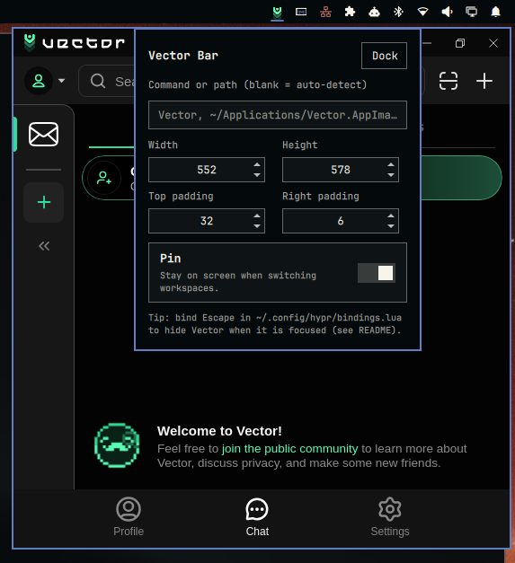

# Vector Bar

Omarchy bar widget that toggles the Vector chat like a popover. Vector Bar is config + an Omarchy shell plugin. No Vector app source changes.



## Features

- Icon is greyscale/color - when Vector is running or not.
- **Right click** - settings popup (size, paddings, pin, command, dock).
- **Left click** (while not running) - launches Vector and anchors it.
- **Left click** (while running) - toggles window visible/hidden.
- Multiple monitor support - Bring Vector to your current monitor.
- Reposition and resize as needed - the plugin will remember
- [Optional] - Bind ESC key to hide Vector window.

## Requirements

- [Omarchy](https://omarchy.org/) (Hyprland + omarchy-shell)
- Vector installed somewhere Vector Bar can find (see **Finding Vector** below)

## Pieces

| File | Role |
| --- | --- |
| `BarWidget.qml` | pill; left-click toggles, right-click opens settings |
| `SettingsPopup.qml` | settings card (paddings, size, pin, command, Dock) |
| `bin/vector-toggle` | launch / show / hide / dock (`--show` / `--hide` / `--dock`) |
| `bin/vector-esc` | Escape helper: hide if Vector is focused, else forward Escape |
| `install-dev.sh` | local/dev rsync into `~/.config/omarchy/plugins/<id>/` and validate |

## Install

```bash
omarchy plugin add https://github.com/BonesGit/omarchy-vector-bar.git --enable
```

The widget lands in the right section of the bar (after the tray). Runtime
float/pin is injected by the toggle on launch — no Hyprland config file is
required.

## Update

```bash
omarchy plugin update io.github.bonesgit.omarchy-vector-bar
```

## Remove

```bash
omarchy plugin remove io.github.bonesgit.omarchy-vector-bar
```

Plugin settings in `~/.config/io.github.bonesgit.omarchy-vector-bar/` are left
in place; delete that directory yourself if you want a clean slate.

Hide parks Vector on Hyprland’s `special:vector-bar` workspace (untoggled —
no bar chip). That name is owned by this plugin; avoid using the same special
workspace for something else. Removing the plugin does not delete the
workspace — it is simply empty afterward.

### Manual / development install

Prefer `omarchy plugin add` for normal use. For a local clone (Omarchy refuses
symlinks inside a plugin folder), use the helper:

```bash
./install-dev.sh
omarchy restart shell
omarchy plugin enable io.github.bonesgit.omarchy-vector-bar --section right --after omarchy.tray   # once
```

After editing this repo, run `./install-dev.sh` again and `omarchy restart shell`.
Live bar instances do not pick up plugin-dir copies on their own.

### Finding Vector

On launch the toggle resolves the binary in this order:

1. Plugin setting `command` (absolute path, `~/…`, or a name on `PATH`)
2. `Vector` or `vector` on `PATH`
3. `Exec=` from `Vector.desktop` / `vector.desktop` under

   `~/.local/share/applications`, `/usr/local/share/applications`, or
    `/usr/share/applications`
4. Newest matching `Vector*.AppImage` under `~/Applications`,

   `~/.local/bin`, or `/opt` (and a few fixed names)

If nothing is found, a Hyprland notification explains how to fix it.

**AppImage users:** put the AppImage on `PATH`, under `~/Applications`, or
set `command` in the settings popup / `settings.json`, e.g.:

```json
{ "command": "~/Applications/Vector.AppImage" }
```

**Dev builds:** either `export PATH="$HOME/projects/Vector/src-tauri/target/release:$PATH"`
or set `command` to that binary. A `.desktop` `Exec=` that points at your
release build also works.

### Escape to hide (optional, manual)

The plugin does **not** install Hyprland keybinds. Add this to
`~/.config/hypr/bindings.lua`, then save (or `hyprctl reload`):

```lua
o.bind(
  "ESCAPE",
  "Hide Vector if focused (Vector Bar)",
  os.getenv("HOME") .. "/.config/omarchy/plugins/io.github.bonesgit.omarchy-vector-bar/bin/vector-esc"
)
```

Or call hide from any bind: `…/bin/vector-toggle --hide`.

## Settings

Edit from the right-click settings popup on the bar pill. Values live in
`~/.config/io.github.bonesgit.omarchy-vector-bar/settings.json` (not
`shell.json` — that file only needs the layout stub
`{ "id": "io.github.bonesgit.omarchy-vector-bar" }`).

| Key | Default | Meaning |
| --- | --- | --- |
| `command` | `""` | Vector binary/AppImage or PATH name; blank = auto-detect |
| `width` / `height` | `385` / `640` | Size at launch; updated on hide/quit after a manual resize |
| `topPadding` | `32` | Gap below the bar (px) |
| `rightPadding` | `6` | Gap from the right edge (px) |
| `pin` | `true` | Pin (stays across workspace switches while visible) |

You can also edit that JSON by hand. Older installs that used the previous
plugin id (`io.github.bonesgit.omarchy-vector`), bar-entry keys, or a legacy
`size.json` are migrated into this `settings.json` on first run.

## Notes

- Window match key is Hyprland class `Vector`.
- Hide parks the window on `special:vector-bar` (untoggled special workspace;
  Hyprland has no minimize). Do not reuse that name for other windows.
- Dispatches always target `window = "address:0x..."` — acting on the
  active window silently no-ops right after a workspace move.
- `monitors -j` reports native mode sizes; rotated monitors need the visual
  rect from `hyprctl layers` (`omarchy-background`).

### Vector window-state file

Vector (Tauri + `tauri-plugin-window-state`) restores geometry from
`~/.config/io.vectorapp/.window-state.json` at launch and ignores compositor
resizes. Vector Bar seeds the `main` entry’s width/height there before spawn
(and again when remembering a size) so the configured size actually sticks.
Only that geometry is touched; other keys (including per-miniapp state) are
preserved. If Vector changes that file’s format, launch sizing may break
until this plugin is updated.
